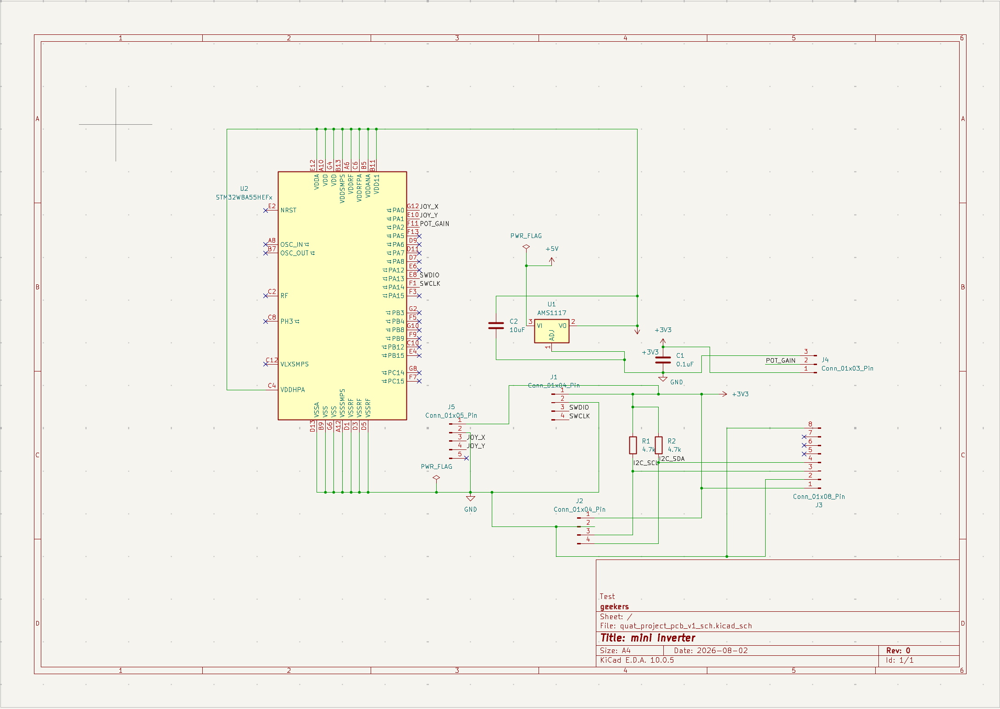

# Quaternion Attitude Control

Quaternion-based attitude determination and control for a rigid body in orbit,
running on an ATmega2560 against a physics plant simulated in a custom Wokwi
chip. The MCU never sees the true attitude — it estimates it from a noisy
accelerometer and gyroscope, and closes a PD loop on quaternion error.

The interesting constraint is that the AVR has **no floating-point unit**. Every
`sin`, `sqrt` and quaternion product is a software routine, and the control loop
still has to close at a usable rate.

---

## How it works

```
   ATmega2560  (sketch.ino)                     Custom chip  (chip/chip.chip.c)
  ┌────────────────────────────┐               ┌──────────────────────────────┐
  │ Mahony fusion  accel+gyro  │◄──── I²C ─────│ Euler's equations, RK4       │
  │        ↓                   │   0x42        │ Exponential-map quaternion   │
  │ q_est                      │   400 kHz     │ integration @ 1 kHz          │
  │        ↓                   │               │                              │
  │ PD law on quaternion error │──── τ ───────►│ Noisy accel + gyro out       │
  │        ↓                   │               │ q_true (scoring only)        │
  │ OLED horizon, streamed     │               └──────────────────────────────┘
  └────────────────────────────┘
     joystick → attitude command
     pot      → gain multiplier
```

The plant integrates angular velocity with RK4 and attitude with the exponential
map, which is norm-preserving by construction. The MCU runs a Mahony
complementary filter to fuse the accelerometer's gravity reference against gyro
integration, then applies

```
q_err = q_est⁻¹ ⊗ q_cmd
τ     = Kp · sign(q_err.w) · q_err.vec  −  Kd · ω
```

`sign(q_err.w)` is the unwinding fix. `q` and `−q` are the same rotation, so a
negative scalar part means the controller is about to rotate the long way around;
negating flips it to the short path. It is four characters and it is the whole
point of the naive-vs-optimized comparison below.

### Conventions

Most quaternion bugs are two individually-correct pieces of code disagreeing
about convention. This project pins them:

| Thing | Choice |
|---|---|
| Storage order | `q = [w, x, y, z]` — scalar first |
| Algebra | Hamilton, not JPL |
| Meaning of `q` | rotates a vector **from body frame into world frame** |
| `ω`, `τ` | body frame; rad/s and N·m |
| Wire format | little-endian `float32` |
| Angles on the wire | radians — degrees only for display |

Euler angles are computed for the OLED and **never fed back into control**.

---

## Results

Apart from the one paragraph that quotes the recorded Wokwi CSVs, the numbers in
this section come from the software-in-the-loop harness in [`test/`](test/): the real `sketch.ino` and `chip/chip.chip.c`, unmodified,
built with the real Adafruit libraries on a simulated clock and I²C bus, with
per-iteration CPU time measured on a cycle-accurate AVR simulator. What that
does and does not model is spelled out under [Testing](#testing). None of it
has been re-run in Wokwi yet.

### Unwinding: the naive law goes the long way round

Both laws start from rest, 359° from the command, and run for 10 s:


| start | naive: path travelled | corrected: path travelled | naive settles (< 2°) | corrected settles |
|---:|---:|---:|---:|---:|
| 181° | 194.2° | 192.0° | 2.27 s | 2.30 s |
| 270° | 284.0° | 99.2° | 2.73 s | 1.96 s |
| **359°** | **372.1°** | **3.5°** | **5.55 s** | **0 s** |

Path is integrated from the plant's ground truth, so it runs a few degrees past
the geometric distance (overshoot at ζ = 0.7, plus noise-driven jitter). The
noise comes from the C library's `rand()`, so the figures move by about a degree
between platforms: these are macOS, and CI's Linux run gives 373.1° and 3.7° at
359°.

At 359° the body is physically 1° off. The naive controller swings it through
180° of error and all the way round before it settles; the corrected one nudges
it 1°. At 181° the two are indistinguishable, because the long way is 181° and
the short way 179°. A 2° difference is inside the noise.

That is why the recorded Wokwi runs in [`results/`](results/) never showed the
effect: they were taken at 181°. Their starting errors, 180.91° and 179.09°,
are one attitude measured two ways. Over the window both runs cover (to 2.74 s)
they travel **238.9° naive and 237.4° corrected**, and their different final
errors (1.24° vs 0.00°) are run length: the naive run stopped at 2.7 s, the
corrected one ran to 5.7 s. Those CSVs also predate the current plant (they
start from a 5 rad/s tumble, the chip now starts at rest), and they are kept
only as a record.

The SIL gets to 359° by starting the plant and the estimator together, as if
the body had been pushed once round. Wokwi has no hook for that yet. The
blueprint's `0x60` control register is where it would go. The naive build is
`pio run -e unwinding_demo` (`-DUNWINDING_DEMO=1`).

`sign(q_err.w)` switches discontinuously at 180°, which the literature
(Mayhew, Sanfelice & Teel, 2011) shows can chatter under measurement noise, and
the standard fix is hysteresis. It was checked here and **not** added: from
exactly 180° the corrected law leaves the 170° band 27 ms later than it does
from 178°, and settles at the same moment.

### The control loop was running at 23 Hz

The diagram used to say 400 kHz and 30 Hz. Neither was true:

| | IMU bus | control rate | worst loop period | OLED |
|---|---:|---:|---:|---:|
| before (`73c03f0`) | 100 kHz | **22.9 Hz** | **45.3 ms** | 21.9 FPS |
| after | 400 kHz | **183.8 Hz** | **6.8 ms** | 10.0 FPS |

*5 s with the stick deflected. CPU measured, bus and ADC modelled, see [Testing](#testing).*

Three things were stacked on top of each other:

1. **`display.begin()` reset the bus to 100 kHz.** Adafruit_SSD1306 restores the
   I²C clock to its `clkAfter` constructor argument after every transfer, and
   that defaults to 100 kHz, so `Wire.setClock(400000)` in `setup()` was undone
   one line later. The constructor now gets 400 kHz for both.
2. **`display()` blocked for ~30 ms.** It pushes 1,024 bytes plus headers in one
   call: ~25 ms of bus at 400 kHz, plus ~5 ms of CPU feeding `Wire.write()` (by
   subtraction from the measured UI iteration below). With
   the render and the telemetry, the UI block took longer than its own 33 ms
   timer, so it fired on *every* iteration. The framebuffer now streams two
   31-byte chunks per loop, ~1.5 ms of bus each time. Frames drop to 10 FPS,
   which is the blueprint's own target for an artificial horizon.
3. **Telemetry printed floats.** `Serial.print(x, 4)` costs ~9,000 cycles a value
   in soft float, and the line has eight of them. It now formats them as fixed
   point by subtraction: the same text (checked over 20,001 values in
   [-1, 1]) in a quarter of the cycles. It also never lands in the same
   iteration as a render, so the two worst cases don't stack.

Measured on simavr (ATmega2560, 16 MHz), with the bus stubbed out to isolate CPU:

| | cycles | time |
|---|---:|---:|
| `sin` / `cos` | 1,950 / 2,013 | 122 / 126 µs |
| `atan2` / `asin` | 3,108 / 1,308 | 194 / 82 µs |
| float multiply / divide | 145 / 495 | 9 / 31 µs |
| one control iteration, now (2 OLED chunks) | 40,221 | 2.5 ms |
| render iteration, now | 82,545 | 5.2 ms |
| telemetry iteration, now | 58,452 | 3.7 ms |
| UI iteration, before (render + `display()` + telemetry) | 233,066 | 14.6 ms |

Four trig calls build the command quaternion every loop, about 0.5 ms of the
2.5. The compiler had already folded `quat_from_euler`'s `yaw = 0` and merged
the render's repeated `sin(roll)`/`cos(roll)`; hand-hoisting those measured no
change and was dropped.

The firmware now reports this itself: the ninth telemetry column is the worst
loop period since the previous line, in µs. Run it in Wokwi and read that column
to check the model.

### Smaller fixes

- **A dropped IMU read lost its interval's rotation.** `last_micros` advanced
  before the read and the early return skipped the integration, so the
  estimator never saw that span. Spinning at 0.5 rad/s in yaw (which gravity
  can't correct) with 10% of reads dropped, the estimate was 11.8° off truth after
  4 s. With the next good sample integrating across the gap, it's 0.08°.
- **The plant latch holds.** The chip snapshots its registers when a transaction
  opens. In the SIL, 187 of 370 reads have a 1 kHz tick land mid-transfer, and all
  370 still return one sample. Without the latch 174 would have been spliced
  from two.
- The torque write still used bare `0x42`/`0x50` after the register names were
  introduced. It now uses `PLANT_ADDR`/`REG_TORQUE`.

### Gains

Treating each axis as `J·θ̈ = τ` and using the small-angle result `q_err.vec ≈ θ/2`,
the effective proportional gain is `Kp/2`:

```
ωn = sqrt(Kp / (2·J))          ζ = Kd / (2·sqrt(Kp·J/2))
```

With `J = [1, 2, 3]`, the shipped gains `Kp = [18, 36, 54]` and
`Kd = [4.2, 8.4, 12.6]` give **ωn = 3.0 rad/s and ζ = 0.7 on all three axes**.

The front-panel knob scales `Kp` and `Kd` together by `m ∈ [0.1, 3.0]`. Because
`ζ` depends on `Kd/sqrt(Kp)`, scaling both by `m` scales damping by `√m` — so the
knob sweeps ζ from 0.22 (ringing) to 1.21 (sluggish), passing through 0.7 at
m = 1. The knob is a damping control wearing a gain control's clothing.

---

### `invSqrt`: a small win on the AVR, and one place it was a loss

The Quake III reciprocal square root is worth having *or* worth deleting
depending entirely on whether the part has an FPU:

| target | FPU | verdict |
|---|---|---|
| **Arduino Mega** (ATmega2560), the Wokwi prototype | none | **wins, slightly:** 730 cycles against 979 for `1.0f/sqrtf` (simavr). That's ~16 µs a loop, 0.3% of the period |
| **ESP32** (Xtensa LX6) | yes | **should lose.** `1.0f/sqrtf(x)` is a couple of instructions and correctly rounded, and the trick also pays to move between integer and float register files. *Not measured.* |
| **STM32WBA55** (Cortex-M33F), the custom board | yes | **should lose**, same reason. *Not measured.* |

`sketch.ino` selects on `__AVR__` rather than assuming, and the AVR path
type-puns through `memcpy`, not `*(long*)&y`, which is a strict-aliasing
violation.

One Newton step leaves a relative error of ~1.7e-3. That's fine for the
accelerometer, whose direction is all that matters, but not for `q_est`, which
it would leave biased off unit norm every loop. A second Newton step fixes the
accuracy, but on the AVR it measures **1,250–1,300 cycles (depending on how the
build inlines it): slower than the 979-cycle library call it was meant to beat**,
and still less accurate. So the quaternion now uses `1.0f/sqrtf` on every
target. That takes ~300 cycles off every loop (40,500 → 40,186 per iteration,
measured) and makes the normalisation exact.

---

## The board



An STM32WBA55HEFx (Cortex-M33 + FPU, integrated radio) on 3V3 from an AMS1117
LDO, with the joystick on `PA0`/`PA1`, the gain potentiometer on `PA2`, SWD on
J1, and 4.7 kΩ I²C pull-ups to an off-board IMU on J3.

**v1 is a schematic, and it should not be fabricated as drawn.** The whole
design is 11 components. Tracing the netlist out of the `.kicad_sch` rather than
eyeballing the sheet, in severity order:

1. **`VDD11` is tied to +3V3.** Every supply pin — `VDD`, `VDDA`, `VDDANA`,
   `VDDHPA`, `VDDRF`, `VDDRFPA`, `VDDSMPS` **and `VDD11`** — sits on one net.
   `VDD11` is the 1.1 V core/radio domain, not a supply input. Driving 3.3 V
   into it is a part-killer, and it is consistent with the next item: the SMPS
   that is supposed to *produce* that rail has been no-connected instead.
2. **`VLXSMPS` is no-connect.** The internal SMPS needs its inductor between
   `VLXSMPS` and `VDD11`, or the part must be strapped for LDO mode per the
   datasheet's power-supply scheme. As drawn it is neither, which is how 1
   happened. **Fix these two together — read the datasheet's supply table and
   redraw the power section from it.**
3. **The package is `ST_WLCSP-41_2.98x2.76mm_P0.4mm_Stagger`.** A 41-ball
   wafer-level chip-scale part on 0.4 mm staggered pitch: bare die, no leads.
   That needs HDI with via-in-pad and laser microvias, a stencil and reflow, and
   it cannot be hand-soldered, reworked, or probed. It is also light-sensitive.
   The QFN version of the same silicon is routable on two layers and solderable
   with an iron. Unless there is a size constraint that justifies it, **this one
   choice is what makes the board unbuildable at hobby scale.**
4. **Decoupling is one capacitor.** `C1` (0.1 µF) and `C2` (10 µF) are the only
   caps on the sheet, both at the regulator. Eight supply pins want ~100 nF each
   placed at the ball, plus bulk. On a normal package this is the single most
   common reason a first article is dead on arrival.
5. **No crystal.** `OSC_IN`/`OSC_OUT` are no-connect, so this runs on the
   internal RC — which rules out the radio that is the reason to choose a WBA55.
   Either add the 32 MHz crystal or drop to a cheaper, non-wireless part.
6. **`NRST` floats.** It wants the usual 100 nF to ground.
7. **LDO output cap is light.** The AMS1117 wants ≥10 µF (the datasheet suggests
   22 µF tantalum) to stay stable; 0.1 µF alone is marginal.
8. **The project's root sheet is empty.** `hardware/quat_project.kicad_sch` is a
   blank A4 page, and the real design lives in
   `quat_project_pcb_v1_sch.kicad_sch`, which nothing references — so opening the
   project shows nothing. Every symbol's instance path is also still bound to
   `(project "mini inverter")`, and the title block says the same. The design was
   started by copying another project and never rebound.

**There is no layout.** `hardware/quat_project.kicad_pcb` is an empty board file
— no stackup, no footprints, no traces. Footprints *are* assigned to all 11
symbols, so the netlist would import; nothing has been placed or routed.

➡️ **[`hardware/power-section.md`](hardware/power-section.md)** is the corrected
wiring to redraw from — both supply modes with the exact pin connections and
values, the package change, and what to check before ordering.

## Known limitations

The simulation is honest about what it does not model. These are the places where
these results would not survive contact with hardware:

- **The gyro has no bias.** The plant adds zero-mean noise only. Rejecting slow
  gyro bias is the main reason a Mahony filter exists, and this sim never asks it
  to. The `0x60` control register that would inject bias is specified in the
  blueprint and not implemented.
- **The accelerometer measures gravity and nothing else.** No linear
  acceleration is modelled, so the classic failure mode — a manoeuvring vehicle
  whose accelerometer stops pointing at the ground — is never exercised. This is
  the single largest gap between this sim and a real vehicle.
- **Noise is uniform, not Gaussian, and `rand()` is never seeded.** Every run is
  bit-identical. Good for reproducibility, useless for characterising variance.
- **The MCU Euler-integrates `q` and renormalises.** The plant uses the
  exponential map; the MCU does not, which contradicts §2.4 of the blueprint. It
  is standard Mahony formulation, but the discrepancy is unmeasured.
- **`dt` is unclamped.** A stalled loop feeds an arbitrarily large step into the
  integrator. With the worst period now ~7 ms this only matters if the bus hangs.
  Clamping would be wrong too, because it throws the rotation away.
- **The recorded CSVs predate the current plant** (a 5 rad/s tumble start; the
  chip now starts at rest) and were taken at 181°, where unwinding can't show.
  The SIL results above replace them.
- **Nothing here has run on silicon or been re-run in Wokwi.** The SIL's CPU
  costs are measured, but its bus timing is protocol arithmetic, its ADC is the
  datasheet figure, and its plant is the same chip code Wokwi runs.
- **Wokwi does not simulate ADC source impedance**, so the analog input circuit
  is validated only in principle.
- **The SIL's timing is a model.** See [Testing](#testing) for exactly which
  parts are measured.

---

## Running it

Open the project in [Wokwi](https://wokwi.com) — `diagram.json` and `sketch.ino`
must stay in the repository root, which is why the firmware is not tucked into a
subdirectory. The custom plant builds from `chip/chip.chip.c`.

Telemetry streams over serial at 115200 baud, 9 columns at 30 Hz:

```
q_est.w, q_est.x, q_est.y, q_est.z, q_true.w, q_true.x, q_true.y, q_true.z, max_dt_us
```

`max_dt_us` is the worst control-loop period since the previous line.

Attitude error in degrees is `2·acos(|⟨q_est, q_true⟩|)`, computed downstream so
the metric can change without reflashing.

> **`q_true` is for scoring only.** It is read inside the telemetry block, after
> the torque command has gone out, into a local that leaves scope immediately —
> so the control path has no name bound to it. The estimator does not get to see
> the answer.

---

## Testing

```bash
pio run -e megaatmega2560 -e unwinding_demo   # firmware, both laws; also fetches the libraries
make -C test                                  # SIL tests
make -C test before-after                     # CPU cycles on simavr + loop-timing table, 73c03f0 vs now
make -C test plot                             # results/unwinding-359.svg
```

CI builds both firmwares and runs the tests and the simavr benchmark on every push.

The SIL compiles `sketch.ino` three times into separate namespaces (as is, with
`UNWINDING_DEMO=1`, and as of `73c03f0` for the before/after), against small
Arduino, Wire and Wokwi-chip shims. The Adafruit libraries are the real ones, so
the bus traffic they generate, including the clock reset, comes from their
code, not from a model of it. Each scenario runs in its own process, scored
against the plant's ground truth, which the firmware never sees.

What's measured and what's modelled:

| | source |
|---|---|
| firmware and plant logic | the real code, unmodified |
| CPU time per loop iteration | **measured**: cycle counts from simavr (`make -C test avr-bench`) for each kind of iteration, charged to the simulated clock |
| I²C time | **modelled**: 9 bit-times per byte plus START/STOP, at whatever clock `Wire` was last set to. Leaves out the TWI interrupt's per-byte service time, so it's a floor |
| `analogRead` | **modelled**: 104 µs, the datasheet's 13 ADC clocks at 16 MHz / 128 (simavr completes it in 26 µs) |
| plant | `chip/chip.chip.c` on a 1 kHz timer, interleaved with the bus byte by byte |

The tests check that IMU traffic runs at 400 kHz, that streamed frames reach the
OLED's RAM intact (rebuilt from the bytes on the wire), that no loop period
exceeds 8 ms, the 359° unwinding result, the dropped-read fix, the plant latch,
and that the fixed-point telemetry matches `Serial.print(x, 4)`.

## Layout

```
sketch.ino        firmware: fusion, control law, OLED, telemetry
diagram.json      Wokwi wiring
libraries.txt     Wokwi library manifest
platformio.ini    local AVR build: `pio run` (and `-e unwinding_demo` for the naive law)
chip/             custom plant: rigid-body dynamics + simulated IMU
docs/blueprint.md the full design document — maths, register map, milestones
docs/schematic.png v1 schematic as drawn — see "The board" before fabricating
hardware/         KiCad project, plus power-section.md: the corrected wiring to redraw v1 from
results/          recorded runs and plots
test/             software-in-the-loop harness and the simavr cycle benchmark
```

`docs/blueprint.md` is the primary reference: it derives the maths, fixes the
conventions, specifies the I²C register map, and catalogues the traps this
project hit on the way through.
